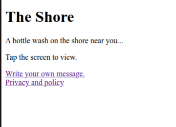
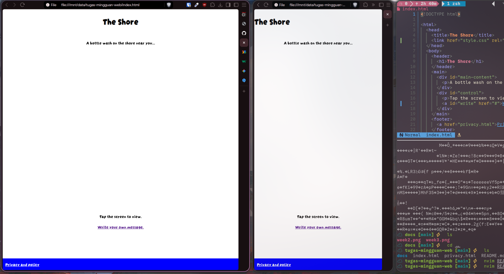

# The Shore

Aplikasi ini bertujuan untuk bahan pembelajaran CSS saya.

## Aplikasi apa ini?

Pengguna dapat menggunakan ini untuk mengirim pesan ke "pantai". Pengguna lain dapat membaca pesan tersebut secara acak. Bertujuan untuk mencari teman, dll.

## Moderasi

Moderasi akan menggunakan Menggunakan [OpenAI Moderation Model](https://developers.openai.com/api/reference/resources/moderations/methods/create) dan secara berkala saya check manual.

## Progress

### Week 2

### Week 3

